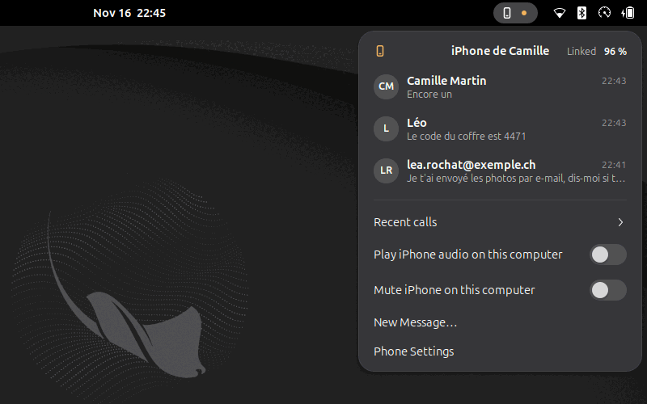
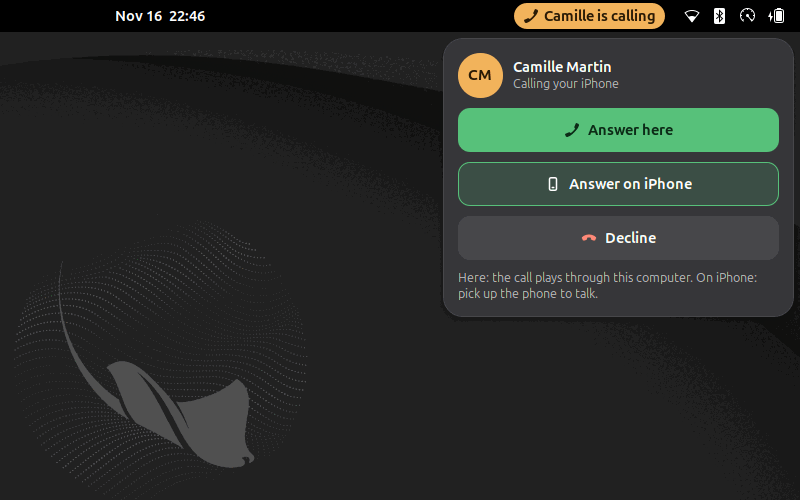

# Landline

Your iPhone's calls, messages and notifications on the GNOME desktop.

Landline links an iPhone to a GNOME computer over Bluetooth. A dot in the top bar says the phone is
linked. When a message or a call arrives the dot grows into a pill, and a card under it lets you answer:
type a reply to an SMS or iMessage, answer or decline a call, choose where the call sound plays.
Notifications of the other iPhone apps appear in the GNOME notification list.

Nothing is installed on the iPhone. No account, no cloud service, no network traffic: the computer
presents itself to the iPhone as a Bluetooth accessory, the way a car or a watch does.

| | |
|---|---|
|  |  |
|  |  |

The screenshots use made-up data.

## Two parts

- **The extension** (`extension/`) is the interface: the indicator, the cards, the setup dialog, the
  settings window. It is written in GJS and published on extensions.gnome.org.
- **The engine** (`engine/`) does the Bluetooth work. It is a small C++ service (`landlined`) that runs
  in your session and talks to BlueZ; the extension talks to it through a Unix socket. It is not part
  of the extension and has to be installed separately. A command-line tool, `landlinectl`, comes with
  it for diagnostics.

## Requirements

- GNOME Shell 51 (Wayland or X11)
- BlueZ 5.7x or later with `obexd` (packages `bluez` and `bluez-obexd`), and a Bluetooth adapter that
  supports both Bluetooth Classic and Low Energy
- PipeWire with WirePlumber (for the call sound)
- systemd (the engine runs as a user service)
- an iPhone; development was done with iOS 26

## Install the engine

There is no binary package yet: the engine is built from source.

Build dependencies, on Debian and Ubuntu:

```sh
sudo apt install build-essential cmake ninja-build pkg-config gettext git \
    libglib2.0-dev libsecret-1-dev libssl-dev libavahi-client-dev \
    libwayland-dev libnotify-dev
sudo apt install bluez bluez-obexd
```

Then:

```sh
git clone https://github.com/d101c/landline.git
cd landline
scripts/build-engine.sh        # configures, builds, runs the unit tests
scripts/install-local.sh       # installs for your user, no root needed
```

The first configuration downloads nlohmann/json and GoogleTest. `install-local.sh --dry-run` prints
what would be done without doing it. What it installs:

| Where | What |
|---|---|
| `~/.local/lib/landline/engine/` | `landlined`, `landlinectl`, translations, the engine's licence |
| `~/.local/lib/landline/landline-setup` | the system setup helper (see below) |
| `~/.config/systemd/user/landline-engine.service` | the user service, enabled and started |
| `~/.local/share/gnome-shell/extensions/landline@d101c.github.io/` | the extension |

The scripts print their messages in French.

### Bluetooth settings an iPhone needs

Two system settings must be in place before pairing. Many systems already have them.

- **BlueZ experimental mode**, only with BlueZ older than 5.88: without it there is no Bluetooth LE
  link to the iPhone, so no notifications.
- **L2CAP ERTM enabled**: some systems turn it off (an old workaround for Xbox controllers). Without it
  messages and contacts cannot be read.

Check, without changing anything:

```sh
~/.local/lib/landline/landline-setup status
~/.local/lib/landline/landline-setup apply --dry-run
```

If `status` says `"ready":true` and both `persistent` values are `true`, there is nothing to do.
Otherwise:

```sh
sudo ~/.local/lib/landline/landline-setup apply
```

`apply` writes a systemd drop-in for `bluetooth.service` (only if experimental mode is needed), a
small unit that keeps ERTM enabled, a copy of itself in `/usr/local/libexec/landline/` and a polkit
action. It restarts Bluetooth only if experimental mode has to be turned on, which disconnects
Bluetooth keyboards, mice and headsets for a few seconds. `revert` removes everything `apply` wrote.

The extension's setup dialog does the same check and walks you through it.

## Install the extension

`scripts/install-local.sh` already copies the extension. To install it alone, from
extensions.gnome.org once it is published there, or from this repository:

```sh
scripts/pack-extension.sh
gnome-extensions install --force dist/landline@d101c.github.io.shell-extension.zip
```

Log out and back in (on Wayland the Shell only discovers a new extension at startup), then:

```sh
gnome-extensions enable landline@d101c.github.io
```

## Link your iPhone

1. Click the phone glyph in the top bar. The setup dialog opens.
2. If a Bluetooth setting is missing, the first step says which one and offers to change it.
3. On the iPhone, open Settings › Bluetooth and keep that page open. The computer appears in the list;
   tap it.
4. Both devices show a six-digit code. Check that they match, confirm on the computer, tap Pair on the
   iPhone.
5. On the iPhone, tap the ⓘ next to the computer's name and turn on **Show Message Notifications**,
   **Sync Contacts** and **Share System Notifications**. The dialog ticks each one as it comes on.
6. Send yourself a message to see it arrive.

After that the iPhone links by itself whenever it is in range.

## Uninstall

```sh
sudo /usr/local/libexec/landline/landline-setup revert   # only if you ran "apply"
scripts/uninstall-local.sh            # add --purge to remove kept messages and settings too
```

On the iPhone: Settings › Bluetooth › ⓘ next to the computer › Forget This Device.

## Known limits

- iPhone only.
- Replies can be typed for SMS and iMessage. For WhatsApp, Telegram and Signal the notification is
  shown and "Reply in app" opens the app's own client; nothing is sent from Landline itself.
- Photos, voice messages and other attachments are not shown. A group conversation cannot be started
  from the computer.
- The extension is inactive on the lock screen.
- One iPhone at a time.
- The call sound depends on the Bluetooth adapter and on PipeWire's hands-free support; on some
  machines it is better left on the iPhone (there is a button for that on the call card).
- Interface in English only for now.

## Development

```sh
tests/run.sh                # state model and engine client, against a fake engine
system/tests/run.sh         # the system setup helper, in fake roots
system/tests/install.sh     # install and uninstall scripts, in a fake home
scripts/build-engine.sh     # engine build and unit tests
tools/shell-test/run.sh     # the extension in a headless GNOME Shell, with a fake engine
```

Design notes are in `docs/` (in French).

## Licence

- The extension (`extension/`), the system helper (`system/`) and the scripts are under
  GPL-2.0-or-later: see `extension/LICENSE`.
- The engine (`engine/`) is derived from [Tether](https://github.com/zackb/tether) by Zack Bartel and
  stays under the MIT licence: see `engine/LICENSE` and `NOTICE.md`.

## Thanks

To Zack Bartel for Tether, whose Bluetooth work and field notes (`engine/docs/BLUETOOTH.md`) made this
possible, and to the projects Tether itself credits: BlueFerry, ancs4linux and BlueZ.

iPhone is a trademark of Apple Inc. This project is not affiliated with or endorsed by Apple.
