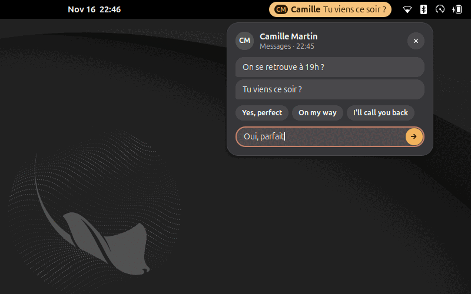
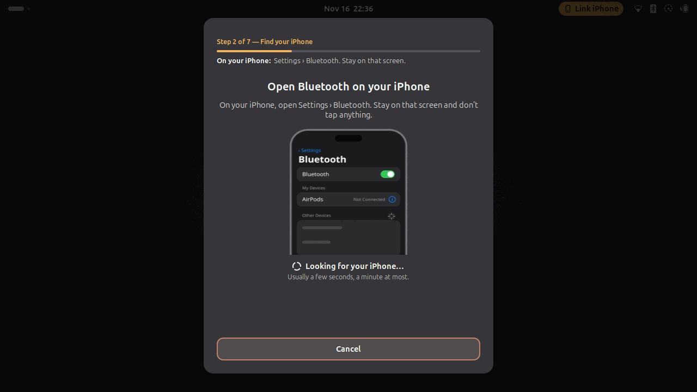

# Landline

Your iPhone's calls, messages and notifications on the GNOME desktop.

Landline links an iPhone to a GNOME computer over Bluetooth. A dot in the top bar says the phone is
linked. When a message or a call arrives the dot grows into a pill, and a card under it lets you answer:
type a reply to an SMS or iMessage, answer or decline a call, choose where the call sound plays.
Notifications of the other iPhone apps appear in the GNOME notification list.

Nothing is installed on the iPhone. No account, no cloud service: calls, messages and notifications
only travel over Bluetooth, and the computer presents itself to the iPhone as a Bluetooth accessory,
the way a car or a watch does.

| | |
|---|---|
|  |  |
|  |  |

The screenshots use made-up data.

## Two parts

- **The extension** (`extension/`) is the interface: the indicator, the cards, the setup dialog, the
  settings window. It is written in GJS and published on extensions.gnome.org.
- **The engine** (`engine/`) does the Bluetooth work. It is a small C++ service (`landlined`) that runs
  in your session and talks to BlueZ; the extension talks to it through a Unix socket. It is not part
  of the extension's package: the extension downloads the release it was made for when you click
  Install (below). A command-line tool, `landlinectl`, comes with it for diagnostics.

## Requirements

- GNOME Shell 51 (Wayland or X11)
- BlueZ 5.7x or later with `obexd` (packages `bluez` and `bluez-obexd`), and a Bluetooth adapter that
  supports both Bluetooth Classic and Low Energy
- PipeWire with WirePlumber (for the call sound)
- systemd (the engine runs as a user service)
- for the one-click install: an x86_64 computer, and libgnome-autoar's introspection data
  (`gir1.2-gnomeautoar-0.1` on Debian and Ubuntu, installed with Files)
- an iPhone; development was done with iOS 26

## Install

1. **Install the extension**, from extensions.gnome.org once it is published there, or from this
   repository:

   ```sh
   scripts/pack-extension.sh
   gnome-extensions install --force dist/landline@d101c.github.io.shell-extension.zip
   ```

   Log out and back in (on Wayland the Shell only discovers a new extension at startup), then turn it
   on in the Extensions app, or with `gnome-extensions enable landline@d101c.github.io`.

2. **Click Install.** The phone glyph in the top bar says *Landline needs its engine*; click
   **Install the Engine…**. Phone Settings opens on its Engine page: click **Install** and watch the
   steps tick by, each with a small picture:

   | Step | What happens |
   |---|---|
   | Download | the engine release this version of the extension was made for, from GitHub (x86_64) |
   | Check | its SHA-256 must match the one written in the extension; otherwise it is thrown away |
   | Install | unpacked into `~/.local/lib/landline/engine`; the engine you had stays beside it |
   | Start | the user service is written, enabled and started; the page waits for the engine to answer |
   | Bluetooth settings | only if this computer needs them: your administrator password, once |
   | Link your iPhone | **Link My iPhone…** opens the guided pairing in the top bar |

   No terminal and no root for the engine itself: it lives in your home folder and runs as a user
   service.

3. **If a step fails**, the page says what happened in one sentence and offers a way on: **Try Again**,
   **Use Previous Engine** (when the new one does not answer), **Skip for Now** (the Bluetooth
   settings can wait), or **Show Steps by Hand**, the same steps as commands to copy into a terminal.

When a later version of the extension brings a newer engine, the menu offers **Update the Engine…**;
the previous engine is kept, and Phone Settings › Engine can go back to it.

What the Install button puts where:

| Where | What |
|---|---|
| `~/.local/lib/landline/engine/` | `landlined`, `landlinectl`, the `landline-le-params` helper, libraries, translations, the engine's licence, `VERSION`, and `system/` (the setup helper and its polkit action) |
| `~/.local/lib/landline/engine.old/` | the engine you had before the last update, if any |
| `~/.config/systemd/user/landline-engine.service` | the user service |
| `~/.config/systemd/user/obex.service.d/landline.conf` | restarts BlueZ's `obexd` if it stops in error at login |

### Bluetooth settings an iPhone needs

Two system settings must be in place before pairing. Many systems already have them, and then the
step is ticked by itself.

- **BlueZ experimental mode**, only with BlueZ older than 5.88: without it there is no Bluetooth LE
  link to the iPhone, so no notifications.
- **L2CAP ERTM enabled**: some systems turn it off (an old workaround for Xbox controllers). Without it
  messages and contacts cannot be read.

The password step copies the setup helper and the `landline-le-params` helper to
`/usr/local/libexec/landline/` after checking their SHA-256 against the values written in the
extension, then runs that root-owned copy. It writes a systemd drop-in for `bluetooth.service` (only
if experimental mode is needed), a small unit that keeps ERTM enabled and a polkit action, and restarts
Bluetooth only if experimental mode has to be turned on (Bluetooth keyboards, mice and headsets drop
for a few seconds). By hand, without changing anything first:

```sh
~/.local/lib/landline/engine/system/landline-setup status
~/.local/lib/landline/engine/system/landline-setup apply --dry-run
sudo ~/.local/lib/landline/engine/system/landline-setup apply
```

`revert` removes everything `apply` wrote.

### Build the engine from source

For development, or on a machine the release does not cover. Build dependencies, on Debian and Ubuntu:

```sh
sudo apt install build-essential cmake ninja-build pkg-config gettext git \
    libglib2.0-dev libsecret-1-dev libssl-dev libavahi-client-dev \
    libnotify-dev
sudo apt install bluez bluez-obexd
```

Then:

```sh
git clone https://github.com/d101c/landline.git
cd landline
scripts/build-engine.sh        # configures, builds, runs the unit tests
scripts/install-local.sh       # installs engine and extension for your user, no root needed
```

The first configuration downloads nlohmann/json and GoogleTest. `install-local.sh --dry-run` prints
what would be done without doing it; it puts the setup helper in `~/.local/lib/landline/landline-setup`
(run `sudo ~/.local/lib/landline/landline-setup apply` once). Phone Settings › Engine recognizes an
engine installed this way and never replaces it without asking. The scripts print their messages in
French.

## Link your iPhone

1. Click the phone glyph in the top bar. The setup dialog opens.
2. If a Bluetooth setting is missing, the first step says which one and offers to change it.
3. On the iPhone, open Settings › Bluetooth and keep that page open. The computer appears in the list;
   tap it.
4. Both devices show a six-digit code. Check that they match, confirm on the computer, tap Pair on the
   iPhone.
5. On the iPhone, tap the ⓘ next to the computer's name and turn on **Show Message Notifications**,
   **Sync Contacts** and **Share System Notifications**. The dialog ticks each one as it comes on.
6. Send yourself a message to see it arrive.

After that the iPhone links by itself whenever it is in range.

## Uninstall

Phone Settings › Engine › **Uninstall the Engine…** stops the service and removes the engine and the
files written for it; its second answer also undoes the Bluetooth settings (password). Your pairing
and settings are kept. Then remove the extension in the Extensions app.

From a source install:

```sh
sudo /usr/local/libexec/landline/landline-setup revert   # only if you ran "apply"
scripts/uninstall-local.sh            # add --purge to remove kept messages and settings too
```

On the iPhone: Settings › Bluetooth › ⓘ next to the computer › Forget This Device.

## Known limits

- iPhone only.
- Replies can be typed for SMS and iMessage. For WhatsApp, Telegram and Signal the notification is
  shown and "Open in …" opens the official app or web client; nothing is sent from Landline itself.
- Photos, voice messages and other attachments are not shown. A group conversation cannot be started
  from the computer.
- The extension is inactive on the lock screen.
- One iPhone at a time.
- The call sound depends on the Bluetooth adapter and on PipeWire's hands-free support; on some
  machines it is better left on the iPhone (there is a button for that on the call card).
- Interface in English only for now.

## Development

```sh
tests/run.sh                # state model and engine client, against a fake engine
system/tests/run.sh         # the system setup helper, in fake roots
system/tests/install.sh     # install and uninstall scripts, in a fake home
scripts/build-engine.sh     # engine build and unit tests
tools/shell-test/run.sh     # the extension in a headless GNOME Shell, with a fake engine
```

Design notes are in `docs/` (in French).

## Licence

- The extension (`extension/`), the system helper (`system/`) and the scripts are under
  GPL-2.0-or-later: see `extension/LICENSE`.
- The engine (`engine/`) is derived from [Tether](https://github.com/zackb/tether) by Zack Bartel and
  stays under the MIT licence: see `engine/LICENSE` and `NOTICE.md`.

## Thanks

To Zack Bartel for Tether, whose Bluetooth work and field notes (`engine/docs/BLUETOOTH.md`) made this
possible, and to the projects Tether itself credits: BlueFerry, ancs4linux and BlueZ.

iPhone is a trademark of Apple Inc. This project is not affiliated with or endorsed by Apple.
